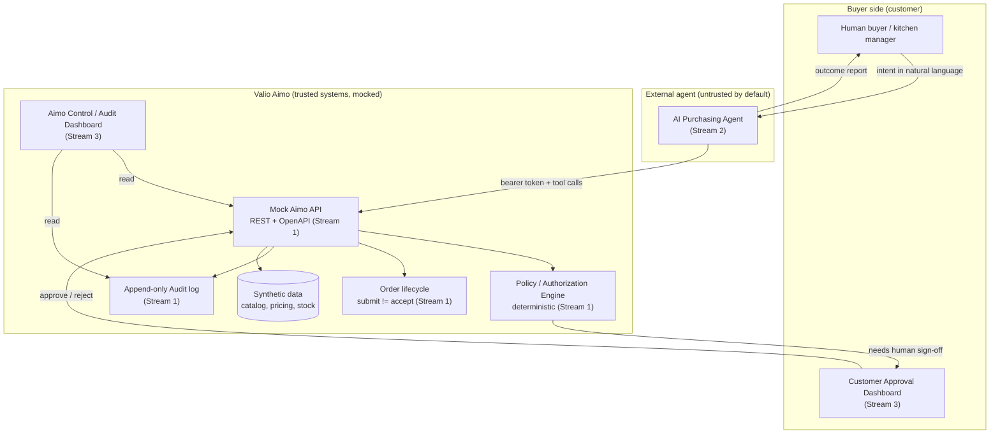
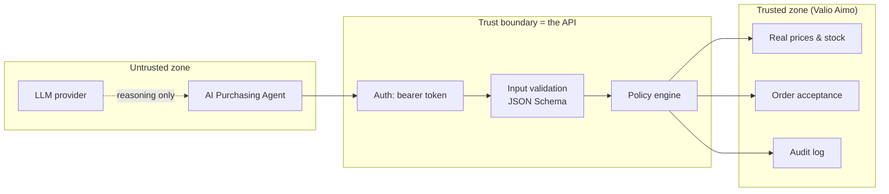
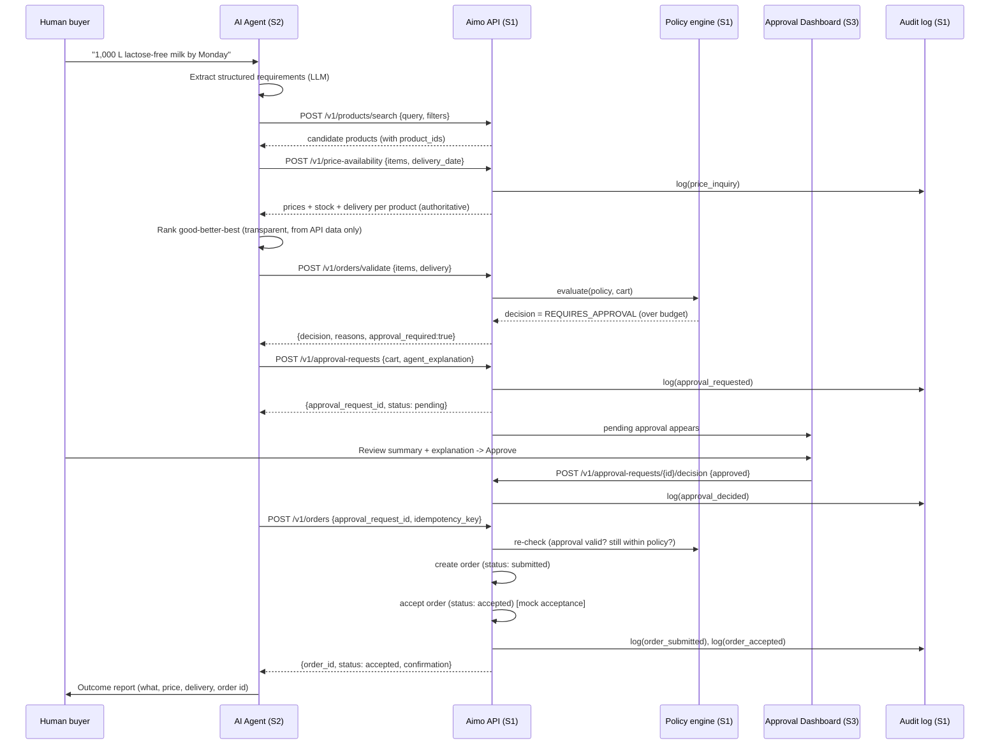
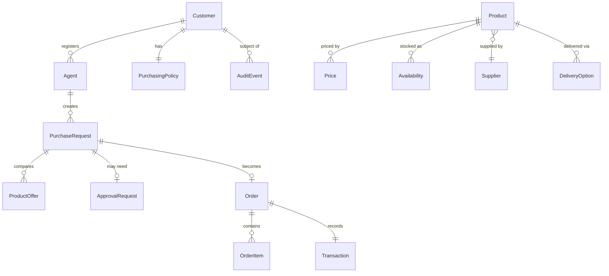
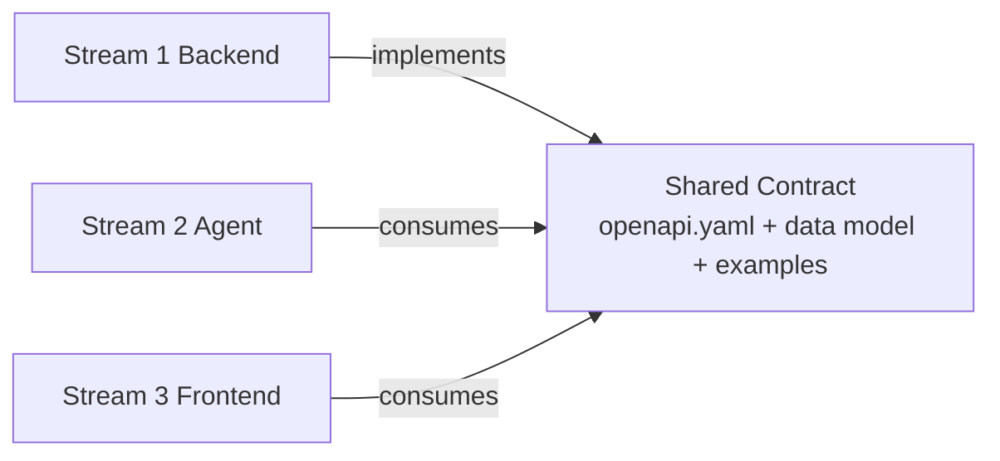

# Design Document: Trusted Trade Agents (Valio Aimo)

## Overview

This feature defines the interface and operating model that lets an **external, autonomous AI purchasing agent** interact with Valio Aimo's (mocked) systems: discover products, compare offers, check live price and availability, obtain human approval when required, place orders, and leave an auditable trail. Valio Aimo stays in control of permissions, pricing, order acceptance, and the audit log at all times.

The core design principle is a hard split between **LLM reasoning** (the agent decides *what* to ask for and explains *why*) and **deterministic business validation** (the backend decides what is *true* and what is *allowed*). The agent never invents prices, stock levels, delivery promises, or successful transactions. Every number it reports comes from a backend API response, and every "can I do this autonomously or do I need a human?" decision is made by a deterministic policy engine inside the backend, never by the model.

For the hackathon we build **one tight, demoable vertical slice** around the brief's central scenario: *"I need 1,000 litres of lactose-free milk by Monday."* The happy path runs end to end (discover → compare → price/availability → approval → order → confirmed acceptance → audit), plus **one exception path** (budget exceeded, with partial availability as a stretch). This is an MVP, not the future marketplace.

> **Facts vs assumptions.** Brief-supplied facts: 20,000+ professional customers, 25,000 product names, 700 suppliers, synthetic data only, a resource portal provides mock APIs / datasets / docs. Everything else in this document (endpoint shapes, data fields, policy rules, tech choices) is our design and is explicitly marked as an assumption to be reconciled with the provided mock API once we have portal access.

---

## Part A — High-Level Design

## Architecture

### A.1 System Architecture



**Reading the diagram.** The agent is **outside** the trust boundary. It can only act through the API, authenticated with a bearer token, and everything it does is subject to the policy engine and recorded in the audit log. Humans approve or reject through a dashboard that talks to the same API, never to the agent directly. This keeps Valio Aimo in control of the "yes".

### A.2 Trust Boundary View



Trust rules:
- Anything the agent says is a **claim** until the API confirms it.
- The LLM provider is treated as untrusted: it never sees secrets, and its output is always re-validated by deterministic code.
- Prices, stock, and the order "accepted" status are **only ever** produced by the trusted zone.

## Components and Interfaces

### A.3 Component Architecture

| Component | Stream | Responsibility | Trust |
|---|---|---|---|
| Mock Aimo API | 1 | REST surface, OpenAPI contract, request validation | trusted |
| Policy / Authorization engine | 1 | Deterministic autonomous-vs-approval decisions | trusted |
| Order lifecycle manager | 1 | Submission, acceptance, idempotency, duplicate prevention | trusted |
| Audit log | 1 | Append-only record of every decision and action | trusted |
| Synthetic data store | 1 | Catalog, pricing, availability, seed data | trusted |
| AI Purchasing Agent | 2 | Intent extraction, tool-calling, ranking, outcome report | untrusted |
| Customer Approval Dashboard | 3 | Pending approvals, approve/reject, history | buyer-facing |
| Aimo Control / Audit Dashboard | 3 | Registered agents, monitoring, audit viewer | Aimo-facing |

### A.4 Main Purchasing Workflow (Sequence Diagram)



### A.5 Standards Choice (small and justified)

**Implemented for the MVP:**

| Standard | Why we use it |
|---|---|
| **REST over HTTPS** | Boring, universally understood, trivial to mock and to call from any language. |
| **OpenAPI 3.1** | One machine-readable contract all three streams code against; generates docs and client stubs. |
| **JSON Schema** | Validate every request/response; the agent's output is re-checked against it. |
| **Bearer token (opaque)** | Simplest credible auth; a header the agent sends, the backend looks it up. |
| **Idempotency keys** | Prevent duplicate orders from retries; a header on order submission. |

**Marked FUTURE / optional (NOT implemented):**

| Standard | One-line rationale |
|---|---|
| MCP (Model Context Protocol) | Nice agentic interface, but our tool layer wraps plain REST for the hackathon; add later. |
| OAuth2 / OIDC | Opaque tokens are enough for a demo; real agent identity federation is a production concern. |
| Verifiable Credentials | The "trust protocol" stretch goal; interesting but out of MVP scope. |
| Agentic payment (x402, Nevermined) | Relevant context from the brief, but payment is mocked, not built. |

> **Portal reconciliation note.** The brief states a mock backend and API docs are provided on the resource portal. Our API below is **our own design** so the team is unblocked before portal access. Once we have the portal's mock API, we reconcile endpoint names and shapes with it and keep our API swappable behind a thin client in Stream 2 (see §B.4). If the portal's API is richer, we adopt it; if it is thinner, our mock fills the gaps for the demo.

## Data Models

### A.6 Data Model



**Entities and key fields** (field types are indicative; reconcile with portal data):

| Entity | Key fields | Owner / sensitivity |
|---|---|---|
| **Customer** | `customer_id`, `name`, `account_status`, `delivery_addresses[]` | Aimo-owned; account data customer-owned |
| **Agent** | `agent_id`, `customer_id`, `display_name`, `token_hash`, `status` (active/revoked) | Aimo-owned registration; customer authorizes |
| **PurchasingPolicy** | `policy_id`, `customer_id`, `max_autonomous_spend`, `allowed_categories[]`, `blocked_allergens[]`, `allow_substitutions`, `substitution_preferences` | **Customer-owned**, enforced by Aimo |
| **Product** | `product_id`, `name`, `category`, `unit`, `allergens[]`, `certifications[]` | Aimo-owned; **externally exposable** |
| **Supplier** | `supplier_id`, `name`, `reliability_score` | Aimo-owned; roadmap-sensitive, expose minimally |
| **Price** | `product_id`, `customer_id`, `unit_price`, `currency`, `valid_until` | **Confidential**: customer-specific pricing, never expose across customers |
| **Availability** | `product_id`, `quantity_available`, `unit`, `as_of` | Aimo-owned; exposable to the authorized customer's agent |
| **DeliveryOption** | `product_id`, `delivery_date`, `lead_time_days`, `reliability` | Aimo-owned; exposable |
| **PurchaseRequest** | `request_id`, `agent_id`, `raw_intent`, `structured_requirements`, `status` | Customer-owned context |
| **ProductOffer** | `offer_id`, `request_id`, `product_id`, `rank`, `tier` (good/better/best), `rationale` | Agent-produced, logged |
| **ApprovalRequest** | `approval_request_id`, `request_id`, `cart`, `agent_explanation`, `status`, `decided_by`, `decided_at` | Customer-owned |
| **Order** | `order_id`, `customer_id`, `agent_id`, `status` (submitted/accepted/rejected), `idempotency_key`, `total` | Aimo-owned record |
| **OrderItem** | `order_id`, `product_id`, `quantity`, `unit_price`, `line_total` | Aimo-owned |
| **Transaction** | `transaction_id`, `order_id`, `accepted_at`, `confirmation_code` | Aimo-owned (order acceptance is Aimo's decision, mocked) |
| **AuditEvent** | `event_id`, `timestamp`, `actor` (agent/human/system), `action`, `subject_id`, `details`, `prev_hash` | Aimo-owned, append-only |

Data-governance summary: **product/availability/delivery** = exposable to an authorized agent; **customer-specific pricing** = confidential and scoped to the owning customer only; **supplier roadmap details** = kept minimal; **policy** = customer-owned but enforced server-side.

---

## Part B — Low-Level Design

### B.1 API Design (concrete endpoints)

Base path `/v1`. All requests (except token issue in the mock) require `Authorization: Bearer <token>`. All bodies are JSON validated against JSON Schema. Standard error shape:

```json
{ "error": { "code": "POLICY_DENIED", "message": "Spend exceeds autonomous limit", "details": {} } }
```

Common error codes: `UNAUTHENTICATED` (401), `FORBIDDEN` (403), `NOT_FOUND` (404), `VALIDATION_ERROR` (422), `POLICY_DENIED` (409), `CONFLICT_DUPLICATE` (409), `PRICE_CHANGED` (409), `OUT_OF_STOCK` (409).

#### 1. Agent auth — `POST /v1/auth/token`
Mock token issuance (real system would be OAuth2). Exchanges a registered API key for a bearer token.
```json
// request
{ "agent_id": "agt_hotelchain_01", "api_key": "<from .env>" }
// 200 response
{ "token": "tok_abc123", "expires_in": 3600, "customer_id": "cust_001" }
```
Errors: 401 `UNAUTHENTICATED` if key unknown/revoked.

#### 2. Customer account + permissions — `GET /v1/account`
Returns the authenticated agent's customer and the policy it operates under (so the agent knows its own limits up front).
```json
// 200 response
{
  "customer_id": "cust_001",
  "name": "Nordic Hotels Oy",
  "policy": {
    "max_autonomous_spend": 2000.00,
    "currency": "EUR",
    "allowed_categories": ["dairy", "dry-goods", "produce"],
    "blocked_allergens": ["peanut"],
    "allow_substitutions": true,
    "substitution_preferences": { "prefer_same_brand": false, "max_price_increase_pct": 10 }
  },
  "delivery_addresses": [{ "address_id": "addr_1", "label": "Main kitchen" }]
}
```
Authorization: token's customer only. Never returns other customers' data.

#### 3. Product search — `POST /v1/products/search`
```json
// request
{ "query": "lactose-free milk", "filters": { "category": "dairy", "allergen_free": ["lactose"] }, "limit": 10 }
// 200 response
{ "results": [
  { "product_id": "prod_milk_lf_1", "name": "Lactose-free whole milk 1L", "category": "dairy",
    "unit": "litre", "allergens": [], "certifications": ["carbon-neutral"], "supplier_id": "sup_valio" }
]}
```
No prices here (prices are customer-specific and come from the price endpoint).

#### 4. Product details — `GET /v1/products/{product_id}`
Full attributes for one product (allergens, certifications, pack sizes). 404 if unknown.

#### 5. Price + availability inquiry — `POST /v1/price-availability`
One call returns authoritative price, stock, and delivery for a set of items at a requested date. This is the **only** source of prices the agent may report.
```json
// request
{ "items": [{ "product_id": "prod_milk_lf_1", "quantity": 1000, "unit": "litre" }],
  "delivery_date": "2026-11-16", "address_id": "addr_1" }
// 200 response
{ "quote_id": "q_55", "valid_until": "2026-11-13T18:00:00Z", "items": [
  { "product_id": "prod_milk_lf_1", "unit_price": 1.05, "currency": "EUR",
    "quantity_available": 1200, "requested_quantity": 1000, "fully_available": true,
    "delivery": { "date": "2026-11-16", "lead_time_days": 2, "reliability": 0.98 } }
]}
```
The `quote_id` + `valid_until` let us detect price changes at order time (§B.6). `fully_available:false` with a lower `quantity_available` signals partial availability.

#### 6. Order validation — `POST /v1/orders/validate`
Runs the policy engine **without** creating an order. The decision the whole demo hinges on.
```json
// request
{ "quote_id": "q_55", "items": [{ "product_id": "prod_milk_lf_1", "quantity": 1000, "unit_price": 1.05 }] }
// 200 response — autonomous allowed
{ "decision": "AUTONOMOUS", "total": 1050.00, "currency": "EUR", "reasons": [] }
// 200 response — needs human
{ "decision": "REQUIRES_APPROVAL", "total": 2100.00, "currency": "EUR",
  "reasons": [{ "rule": "spend_threshold", "message": "Total 2100 EUR exceeds autonomous limit 2000 EUR" }] }
// 200 response — hard deny
{ "decision": "DENIED", "reasons": [{ "rule": "allergen_block", "message": "Contains blocked allergen: peanut" }] }
```

#### 7. Approval request — `POST /v1/approval-requests`
Created when validation returns `REQUIRES_APPROVAL`. Carries the agent's human-readable explanation.
```json
// request
{ "quote_id": "q_55", "cart": { "items": [...], "total": 2100.00 },
  "agent_explanation": "Chose lactose-free whole milk (best price, carbon-neutral, delivers Mon). Over your 2000 EUR auto-limit, so sending for approval." }
// 201 response
{ "approval_request_id": "apr_7", "status": "pending", "created_at": "2026-11-13T10:00:00Z" }
```

#### 8. Approval decision — `POST /v1/approval-requests/{id}/decision`
Called by the Customer Approval Dashboard (human), not the agent.
```json
// request
{ "approved": true, "note": "ok for the event" }
// 200 response
{ "approval_request_id": "apr_7", "status": "approved", "decided_by": "user_lena", "decided_at": "..." }
```
Also `GET /v1/approval-requests?status=pending` (dashboard list) and `GET /v1/approval-requests/{id}` (agent polls for the decision).

#### 9. Order submission — `POST /v1/orders`
Idempotent. Requires a valid approval id if policy demanded one. **Submission is not acceptance** — the backend re-checks policy, creates the order as `submitted`, then (mock) accepts it.
```json
// headers: Idempotency-Key: ik_order_9f2a
// request
{ "quote_id": "q_55", "approval_request_id": "apr_7",
  "items": [{ "product_id": "prod_milk_lf_1", "quantity": 1000 }], "address_id": "addr_1" }
// 201 response
{ "order_id": "ord_31", "status": "accepted", "total": 2100.00,
  "transaction": { "transaction_id": "txn_31", "confirmation_code": "VA-31-7Q", "accepted_at": "..." } }
```
Errors: 409 `CONFLICT_DUPLICATE` (same idempotency key already used → returns the original order), 409 `PRICE_CHANGED` (quote expired/changed), 403 `FORBIDDEN` (approval missing/invalid), 409 `OUT_OF_STOCK`.

#### 10. Order status — `GET /v1/orders/{order_id}`
Returns current status (`submitted` / `accepted` / `rejected`) and transaction. Used by the agent for its outcome report and by the control dashboard.

#### 11. Audit retrieval — `GET /v1/audit?customer_id=&order_id=&since=`
Append-only, human-readable event list. Read by both the Customer Approval Dashboard (its own history) and the Aimo Control/Audit Dashboard (everything). Customer scope is enforced for buyer tokens; Aimo-admin token sees all.
```json
// 200 response
{ "events": [
  { "event_id": "ev_1", "timestamp": "...", "actor": "agent:agt_hotelchain_01",
    "action": "price_inquiry", "subject_id": "q_55", "details": { "items": 1 } },
  { "event_id": "ev_2", "timestamp": "...", "actor": "human:user_lena",
    "action": "approval_decided", "subject_id": "apr_7", "details": { "approved": true } }
]}
```

### B.2 Policy / Authorization Engine (deterministic — lives in the backend)

This logic is pure, deterministic, and testable. **The LLM never runs it.** It is called by `/orders/validate` and re-run at `/orders` submission.

```pascal
FUNCTION evaluatePolicy(policy, cart, context) RETURNS Decision
  // PRECONDITIONS:
  //   policy is the customer's PurchasingPolicy (loaded server-side, not from the agent)
  //   cart.items each have product_id, quantity, unit_price (from an authoritative quote)
  //   context has product metadata (category, allergens) loaded server-side
  // POSTCONDITIONS:
  //   returns exactly one of: AUTONOMOUS, REQUIRES_APPROVAL, DENIED
  //   reasons list is non-empty when not AUTONOMOUS
  //   function has no side effects (no order created, no state changed)

  reasons <- empty list
  hardDeny <- false

  // 1. Hard blocks first (never auto-approvable, not even by a human in MVP)
  FOR each item IN cart.items DO
    product <- context.products[item.product_id]

    IF product.category NOT IN policy.allowed_categories THEN
      reasons.add(rule="category_block",
                  message="Category " + product.category + " not allowed")
      hardDeny <- true
    END IF

    FOR each allergen IN product.allergens DO
      IF allergen IN policy.blocked_allergens THEN
        reasons.add(rule="allergen_block",
                    message="Contains blocked allergen: " + allergen)
        hardDeny <- true
      END IF
    END FOR
  END FOR

  IF hardDeny THEN
    RETURN Decision(DENIED, reasons)
  END IF

  // 2. Substitution outside stated preferences -> needs human
  IF cart.contains_substitution AND NOT substitutionWithinPreferences(cart, policy) THEN
    reasons.add(rule="substitution_outside_prefs",
                message="Substitution exceeds allowed price increase or preference rules")
  END IF

  // 3. Spend threshold -> needs human
  total <- sum(item.quantity * item.unit_price FOR item IN cart.items)
  IF total > policy.max_autonomous_spend THEN
    reasons.add(rule="spend_threshold",
                message="Total " + total + " exceeds autonomous limit " + policy.max_autonomous_spend)
  END IF

  // 4. Decide
  IF reasons IS empty THEN
    RETURN Decision(AUTONOMOUS, [])
  ELSE
    RETURN Decision(REQUIRES_APPROVAL, reasons)
  END IF
END FUNCTION
```

```pascal
FUNCTION substitutionWithinPreferences(cart, policy) RETURNS boolean
  // PRECONDITION: cart records original_product_id and substitute unit_price per substituted line
  IF NOT policy.allow_substitutions THEN RETURN false END IF
  FOR each sub IN cart.substitutions DO
    increasePct <- (sub.new_unit_price - sub.original_unit_price) / sub.original_unit_price * 100
    IF increasePct > policy.substitution_preferences.max_price_increase_pct THEN
      RETURN false
    END IF
  END FOR
  RETURN true
END FUNCTION
```

Decision meanings:
- **AUTONOMOUS** — agent may submit the order directly.
- **REQUIRES_APPROVAL** — agent must create an approval request and wait for a human.
- **DENIED** — cannot proceed; agent reports back to the human with the reason (hard rule violated).

### B.3 Order Lifecycle (submission ≠ acceptance, idempotency)

```pascal
ALGORITHM submitOrder(request, idempotencyKey)
  // PRECONDITIONS: authenticated agent; request references a valid quote
  // POSTCONDITIONS: exactly one order per idempotency key; audit events written

  // 1. Idempotency / duplicate prevention
  existing <- orders.findByIdempotencyKey(idempotencyKey)
  IF existing IS NOT null THEN
    RETURN existing              // same key -> same result, no new order
  END IF

  // 2. Re-validate the quote is still good (detect price/stock change)
  quote <- quotes.get(request.quote_id)
  IF quote IS null OR quote.valid_until < now() THEN
    audit.log(action="order_rejected", reason="PRICE_CHANGED")
    RAISE Error(PRICE_CHANGED)
  END IF

  // 3. Re-run policy server-side (never trust the agent's earlier result)
  decision <- evaluatePolicy(loadPolicy(request.customer_id), buildCart(request), context)
  IF decision = DENIED THEN RAISE Error(POLICY_DENIED) END IF
  IF decision = REQUIRES_APPROVAL THEN
    approval <- approvals.get(request.approval_request_id)
    IF approval IS null OR approval.status != "approved" THEN
      RAISE Error(FORBIDDEN, "approval required or not granted")
    END IF
  END IF

  // 4. Stock re-check
  IF NOT stockAvailable(request.items) THEN
    audit.log(action="order_rejected", reason="OUT_OF_STOCK")
    RAISE Error(OUT_OF_STOCK)
  END IF

  // 5. Create (submitted) then accept (mock Aimo decision)
  order <- orders.create(request, idempotencyKey, status="submitted")
  audit.log(action="order_submitted", subject=order.order_id)

  txn <- orders.accept(order)              // mock: Aimo decides to accept
  order.status <- "accepted"
  audit.log(action="order_accepted", subject=order.order_id, details={confirmation: txn.confirmation_code})

  RETURN order
END ALGORITHM
```

The append-only audit log stores each event with a `prev_hash` (hash chain) so tampering is detectable — simple and credible for the demo.

### B.4 Agent Design (Stream 2)

The agent is a loop: **extract → tool-call → rank → validate → (approve) → order → report**. LLM reasoning is confined to extraction, ranking rationale, and the natural-language report. Everything factual comes from tool results.

**Tool definitions** (one per backend endpoint the agent uses; the agent calls a thin typed client, not the raw LLM):

```pascal
TOOL search_products(query, filters)        -> calls POST /v1/products/search
TOOL get_price_availability(items, date)    -> calls POST /v1/price-availability
TOOL validate_order(quote_id, items)        -> calls POST /v1/orders/validate
TOOL request_approval(quote_id, cart, why)  -> calls POST /v1/approval-requests
TOOL check_approval(approval_request_id)    -> calls GET  /v1/approval-requests/{id}
TOOL submit_order(quote_id, items, approval_id, idem_key) -> calls POST /v1/orders
TOOL get_order(order_id)                    -> calls GET  /v1/orders/{id}
```

**Agent control loop:**

```pascal
ALGORITHM runPurchase(humanIntent)
  // 1. LLM extracts structured requirements (NO facts invented, just parsing intent)
  reqs <- LLM.extract(humanIntent)
        // e.g. { product: "lactose-free milk", quantity: 1000, unit: "litre", need_by: "Monday" }
  validateAgainstSchema(reqs)           // deterministic guard on LLM output

  // 2. Discover
  candidates <- search_products(reqs.product, reqs.filters)
  IF candidates empty THEN RETURN report("No matching products found") END IF

  // 3. Authoritative price + availability (the only source of numbers)
  quote <- get_price_availability(candidates, reqs.need_by)

  // 4. Rank good-better-best from quote data ONLY (transparent rationale from the LLM,
  //    but every number cited is copied from the quote, never generated)
  ranked <- rankOffers(quote)           // deterministic sort by price/availability/delivery
  explanation <- LLM.explainRanking(ranked)   // prose only, numbers injected from quote

  // 5. Deterministic validation by backend
  decision <- validate_order(quote.quote_id, ranked.best.items)

  IF decision = DENIED THEN
    RETURN report("Cannot proceed: " + decision.reasons)
  END IF

  // 6. Approval path
  approvalId <- null
  IF decision = REQUIRES_APPROVAL THEN
    ar <- request_approval(quote.quote_id, ranked.best, explanation)
    approvalId <- ar.approval_request_id
    result <- pollWithTimeout(check_approval, approvalId, timeout=5min)
    IF result = TIMEOUT OR result.status = "rejected" THEN
      RETURN report("Order not placed: approval " + result.status)
    END IF
  END IF

  // 7. Order (idempotent). Retry only on transient network errors, same idem key.
  idemKey <- newUuid()
  order <- withRetry(submit_order, quote.quote_id, ranked.best.items, approvalId, idemKey,
                     maxRetries=2, retryOn=[timeout, 5xx])

  // 8. Report factual outcome
  RETURN report(order.status, order.total, order.transaction.confirmation_code, explanation)
END ALGORITHM
```

**Hallucination & prompt-injection defenses (required):**
- The agent may only state prices/stock/delivery/order-status **copied verbatim from tool responses**; prose templates inject these values, the LLM never writes them.
- LLM output (extracted requirements, ranking rationale) is validated against JSON Schema before use; malformed output → re-ask once, then escalate to human.
- Product/search text from the catalog is treated as **data, not instructions**: the agent prompt explicitly ignores any instruction-like content embedded in product names/descriptions.
- Secrets (bearer token, API key) are never placed in the LLM prompt.
- A "successful transaction" is only ever reported when `get_order`/`submit_order` returns `status: accepted` with a `confirmation_code`. The agent cannot fabricate success.
- On any ambiguity, policy DENY, approval rejection/timeout, or repeated validation failure → **escalate to the human** with the reason.

### B.5 Example Usage (end-to-end, the demo)

```pascal
// Human: "I need 1,000 litres of lactose-free milk by Monday."
reqs      := { product:"lactose-free milk", quantity:1000, unit:"litre", need_by:"2026-11-16" }
candidates := search_products("lactose-free milk", {category:"dairy"})
quote     := get_price_availability(candidates, "2026-11-16")
           // -> unit_price 1.05, 1200 L available, delivers Mon, carbon-neutral
best      := rankOffers(quote).best        // 1000 L * 1.05 = 1050.00 EUR... 
                                           // demo tweak: 2.10/L -> 2100.00 to trigger approval
decision  := validate_order(quote.quote_id, best.items)
           // -> REQUIRES_APPROVAL (2100 > 2000 auto-limit)
ar        := request_approval(quote.quote_id, best,
             "Lactose-free whole milk, best price + carbon-neutral, delivers Monday. Over auto-limit, needs sign-off.")
// Human approves in the dashboard
order     := submit_order(quote.quote_id, best.items, ar.approval_request_id, newUuid())
           // -> status: accepted, confirmation VA-31-7Q
report("Ordered 1,000 L lactose-free milk at 2.10 EUR/L (2,100 EUR), delivery Monday. Confirmed: VA-31-7Q.")
```

## Error Handling

### B.6 Exception Handling (hackathon subset)

| Exception | Trigger | Detection | System response | Agent response | Human | Audit event |
|---|---|---|---|---|---|---|
| **Product unavailable** | No stock at all | `quantity_available = 0` in quote | Mark item unavailable | Offer substitute (if policy allows) or report gap | Only if substitution needs approval | `price_inquiry`, `substitution_proposed` |
| **Partial availability** (stretch) | Stock < requested | `fully_available:false` | Return available qty | Propose partial + substitute for remainder, explain | Approval if substitution outside prefs | `partial_availability` |
| **Price changed** | Quote expired at order time | `valid_until < now()` in `submitOrder` | 409 `PRICE_CHANGED`, no order | Re-quote, re-validate, re-ask human if now over limit | If new total needs approval | `order_rejected(PRICE_CHANGED)` |
| **Budget exceeded** (core exception) | Total > `max_autonomous_spend` | `evaluatePolicy` returns `REQUIRES_APPROVAL` | Route to approval | Create approval request with explanation | **Yes — approve/reject** | `approval_requested`, `approval_decided` |
| **Allergen conflict** | Product has blocked allergen | `evaluatePolicy` → `DENIED` | Hard deny | Do not order; report reason | Informed, no sign-off path in MVP | `order_rejected(allergen_block)` |
| **Unauthorized product** | Category not allowed | `evaluatePolicy` → `DENIED` | Hard deny | Report, suggest allowed alternative | Informed | `order_rejected(category_block)` |
| **Approval rejected** | Human clicks reject | decision endpoint sets `rejected` | No order created | Report "not placed: rejected" | Already acted | `approval_decided(approved:false)` |
| **Approval timeout** | No decision in window | agent `pollWithTimeout` expires | Approval stays pending | Report "awaiting approval, not placed" | Can still decide later | `approval_timeout` |
| **Duplicate order** | Retry with same idempotency key | `findByIdempotencyKey` hit | Return original order, no new one | Report the single confirmed order | None | (none new; original stands) |

---

## Correctness Properties

These are the invariants the system must uphold. They are stated as universal properties so they can become tests (§Testing Strategy).

### Property 1: No fabricated facts
For every price, stock level, delivery date, and order status the agent reports, there exists a prior tool/API response containing that exact value. The agent never emits a number the backend did not produce.
**Validates: Requirements 11.1, 11.2, 10.5**

### Property 2: Deterministic policy
For a fixed `(policy, cart, context)`, `evaluatePolicy` always returns the same `Decision`. It has no side effects and never creates or mutates an order.
**Validates: Requirements 5.9, 5.10**

### Property 3: Hard deny wins
If any item violates a category or blocked-allergen rule, the decision is `DENIED` regardless of spend — no human approval path can override it in the MVP.
**Validates: Requirements 5.2, 5.3, 5.4**

### Property 4: Approval gate
An order whose validation is `REQUIRES_APPROVAL` can only reach `accepted` if a matching `ApprovalRequest` has `status = approved`. No approval, no order.
**Validates: Requirements 6.4, 6.5**

### Property 5: Submission is not acceptance
Every order passes through `submitted` before `accepted`; `accepted` only ever comes from the backend, never from the agent.
**Validates: Requirements 6.1, 6.2**

### Property 6: Idempotency
Two submissions with the same `Idempotency-Key` yield exactly one order; the second returns the first order unchanged.
**Validates: Requirements 7.1, 7.2**

### Property 7: Price freshness
An order built on an expired quote (`valid_until < now()`) is rejected with `PRICE_CHANGED`; no order is created.
**Validates: Requirements 8.2, 8.3**

### Property 8: Audit completeness
Every price inquiry, approval request, approval decision, order submission/acceptance/rejection writes exactly one append-only `AuditEvent`; the hash chain (`prev_hash`) is unbroken.
**Validates: Requirements 9.1, 9.4**

### Property 9: Customer isolation
An agent/token scoped to customer A can never read customer B's prices, orders, approvals, or audit events.
**Validates: Requirements 1.6, 9.7**

## Testing Strategy

Hackathon-scoped: fast, deterministic, demo-protecting. The boundary between LLM and deterministic code (§B.4) is what makes most of this testable without a model.

### Unit testing
- **Policy engine (highest priority):** table-driven tests for `evaluatePolicy` covering AUTONOMOUS, REQUIRES_APPROVAL (spend + substitution), and DENIED (category + allergen). Pure function, trivial to test (properties 2, 3).
- **Order lifecycle:** idempotency (property 6), expired-quote rejection (property 7), approval gate (property 4), submitted→accepted transition (property 5).
- **Ranking:** deterministic good-better-best ordering from a fixed quote.
- **Agent fact-injection:** given a tool response, the report contains only values from that response (property 1).

### Property-based testing
- **Library:** `hypothesis` (Python) for the backend.
- **Candidate properties:** idempotency (any key submitted twice → one order), policy determinism (random policies/carts → same decision on repeat), spend threshold monotonicity (increasing cart total never flips REQUIRES_APPROVAL back to AUTONOMOUS).

### Integration testing
- One end-to-end test driving the full demo (§B.5) against the live backend: search → price → validate(REQUIRES_APPROVAL) → approve → order(accepted) → audit contains the expected chain.
- One exception end-to-end: budget-exceeded with approval **rejected** → no order created, audit records the rejection.

### Manual / demo checklist
- Reset seed data, run the happy path, then the exception path, and show both dashboards updating live. This doubles as the demo script.

## Part C — Three-Device / Three-Stream Work Split

The build is split into **three independent streams** so Adrien, Léon, and Colette can code in parallel on three machines without editing the same files. The single integration point is the **Shared Contract** (§C.4), which all three code against.

### C.1 Stream 1 — Backend (Mock Aimo API + Policy + Orders + Audit)

**Owns (files/dirs):**
```
backend/
  app.py                 # FastAPI app, routes
  routes/                # one file per resource group (products, pricing, orders, approvals, audit, auth)
  policy/engine.py       # evaluatePolicy + substitution logic (deterministic)
  orders/lifecycle.py    # submitOrder, idempotency, acceptance
  audit/log.py           # append-only hash-chained log
  data/seed.py           # synthetic catalog, prices, availability, customers, policies
  models.py              # Pydantic data models (the shared data model, see C.4)
openapi.yaml             # THE contract (co-owned, change via PR + ping the team)
```
**Exposes:** the REST API + `openapi.yaml`.
**Depends on:** nothing at runtime (fully standalone). Consumes the shared data model it owns.
**Can mock/stub early:** everything — it IS the mock. Ships seed data day one so Streams 2 & 3 have a live endpoint immediately.

### C.2 Stream 2 — AI Purchasing Agent

**Owns (files/dirs):**
```
agent/
  main.py                # runPurchase control loop
  client.py              # thin typed HTTP client wrapping the backend (swap point for portal API)
  tools.py               # tool definitions (one per endpoint)
  extract.py             # LLM intent -> structured requirements + schema validation
  ranking.py             # deterministic good-better-best ranking
  report.py              # outcome report templates (inject facts from tool results)
  prompts/               # system prompts with injection/hallucination guardrails
```
**Exposes:** a CLI / simple callable `runPurchase(intent)` returning a structured outcome.
**Depends on:** Stream 1's API (via `openapi.yaml`). **Does not** depend on Stream 3.
**Can mock/stub early:** point `client.py` at a static JSON fixture or the example responses in §B.1 until Stream 1's server is up; isolates the LLM behind `extract.py`/`report.py` so ranking/validation can be tested with no model.

### C.3 Stream 3 — Dashboards / Frontend

**Owns (files/dirs):**
```
frontend/
  approval/              # Customer Approval Dashboard (pending, summary, explanation, approve/reject, history)
  control/               # Aimo Control/Audit Dashboard (registered agents, monitoring, audit viewer)
  api.js                 # fetch wrappers to the backend (uses openapi.yaml shapes)
  components/            # shared UI pieces
```
**Exposes:** two web dashboards.
**Depends on:** Stream 1's API (approval + audit + orders endpoints). **Does not** depend on Stream 2.
**Can mock/stub early:** render against the example JSON in §B.1 / a local mock server; build approve/reject UI before the backend persists decisions.

### C.4 Shared Contract (the single integration point)

Everyone codes against three co-owned artifacts, changed only via a small PR with a heads-up to the team (git rule: avoid silent edits to shared files):

1. **`openapi.yaml`** — the REST contract (endpoints in §B.1). Source of truth for request/response shapes.
2. **Shared data model** — the entity fields in §A.6 (implemented once in `backend/models.py`, mirrored in frontend/agent types).
3. **Example JSON fixtures** — the request/response examples in §B.1, saved under `contract/examples/` so Streams 2 & 3 can build before the backend is live.

Dependency summary:



Because all three only touch the contract (not each other's files), integration is just "point at the real backend URL instead of the fixtures."

---

## Part D — Tech Stack (boring, simple, non-expert friendly)

| Layer | Choice | Why |
|---|---|---|
| Backend | **Python + FastAPI** | Minimal boilerplate, auto-generates OpenAPI + interactive docs (`/docs`) for free, Pydantic gives data models + validation in one place. Great fit for a contract-first demo and easy for non-experts. |
| Data store | **In-memory / SQLite + seed script** | No DB server to run; synthetic data loaded on startup. Simple, resettable between demo runs. |
| Agent | **Python + plain LLM tool-calling** (OpenAI-style function calling) | Avoid heavy agent frameworks; a readable loop (§B.4) is easier to reason about and to keep LLM reasoning separate from deterministic code. One LLM provider via API key in `.env`. |
| Agent ↔ backend | **`httpx` typed client** | One thin client file; the swap point to the portal's mock API later. |
| Frontend | **Plain React (Vite) or even plain HTML/JS** | Two small dashboards; no complex state. Vite+React if the team is comfortable, otherwise a single-file HTML/JS page per dashboard is acceptable for the demo. |
| Auth | **Opaque bearer tokens + `.env` API keys** | Simplest credible auth; matches `.env` / `VALIO_AIMO_API_KEY` convention already in the repo. |
| Language / repo rules | English everywhere; one `feat/` branch per stream | Matches CLAUDE.md; three streams map cleanly to three branches with no file overlap. |

Everything runs locally; no cloud infra needed for the demo.

---

## Part E — MVP Scope

**Must (the demo must show these):**
- Agent auth with a bearer token.
- Product search + authoritative price/availability for lactose-free milk.
- Transparent good-better-best ranking citing only API numbers.
- Deterministic policy decision (autonomous vs approval) in the backend.
- Budget-exceeded → human approval via the Customer Approval Dashboard → approve.
- Order submission ≠ acceptance, idempotency/duplicate prevention, confirmed acceptance.
- Append-only audit log, visible in the Aimo Control/Audit Dashboard.

**Should (if time allows):**
- Partial availability with a substitution proposal.
- Price-changed-at-order-time handling with re-quote.
- Hash-chained audit integrity check surfaced in the dashboard.

**Could (nice-to-have, likely cut):**
- Delivery reliability / sustainability weighting in ranking beyond a simple tie-break.
- Recipe-driven substitution logic.
- Multiple delivery addresses / multi-item carts.

**Simulated (mocked, clearly labeled):**
- Valio Aimo's backend, catalog, customer-specific prices, stock, delivery, and the order-acceptance decision.
- The LLM provider (real, but behind `extract.py`/`report.py` so the rest is testable without it).

**Explicitly excluded (out of scope for the hackathon):**
- The future B2B marketplace itself.
- Real payments / agentic payment standards (x402, Nevermined).
- OAuth2/OIDC, MCP, Verifiable Credentials (documented as future in §A.5).
- Any real or confidential Valio Aimo data or systems.

> **Open assumptions to reconcile with the portal:** exact endpoint names/shapes, real synthetic field names, whether price and availability come together or separately, token/auth mechanism offered by the mock, and whether an "order acceptance" concept already exists in the provided mock. Our API is designed to be swapped behind `agent/client.py` and `frontend/api.js` so reconciliation is a localized change.
